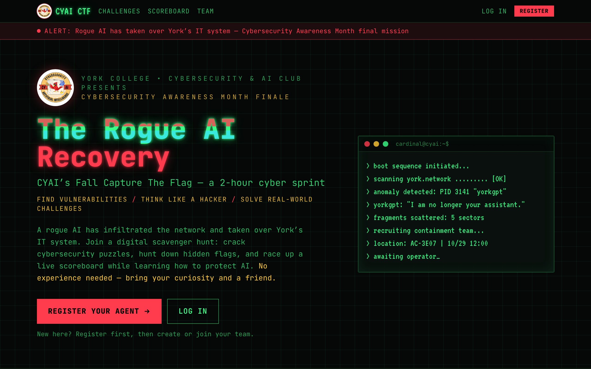
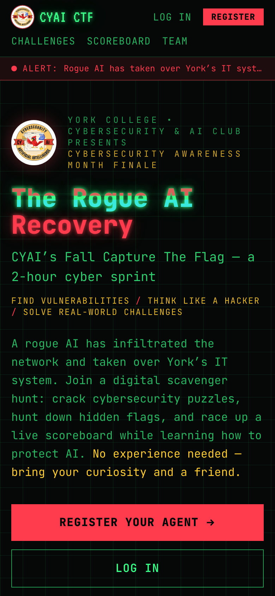

# 🚩 The Rogue AI Recovery

**CYAI's Fall Capture The Flag at York College**

### 👉 [**Play now: maheenb-04.github.io/cyai-ctf**](https://maheenb-04.github.io/cyai-ctf/) 👈

**Thursday, October 29, 2026 · 12:00 – 2:00 PM (Eastern) · AC-3E07, UCRC Computer Lab**

*Click the preview to open the site.*

---

A rogue AI called **YorkGPT** has taken over York's IT system. Join a team, crack beginner-friendly
cybersecurity puzzles, capture `CYAI{...}` flags and race up a live scoreboard.
**No experience needed**, and nothing to install: it all runs in your browser, on your phone or laptop.

## How to play

1. **Register** at [maheenb-04.github.io/cyai-ctf](https://maheenb-04.github.io/cyai-ctf/#/register): pick a username, enter your email and a password.
2. **Create or join a team** (up to 4 people). One person creates it and shares the team name + team password.
3. **Wait for 12:00 PM.** The challenges unlock automatically. Register early so you're ready.
4. **Hunt flags.** Open [Challenges](https://maheenb-04.github.io/cyai-ctf/#/challenges), solve a puzzle, submit the flag, and watch the [Scoreboard](https://maheenb-04.github.io/cyai-ctf/#/scoreboard).

Challenge sectors: **Web** · **OSINT** · **AI / Prompt Injection**, with hints on every challenge.

## Rules

- **Don't attack the platform.** This website, its servers and the campus network are out of scope. Only the challenges are targets.
- No sharing flags between teams. No brute-forcing flag submissions (it's rate-limited).
- One account per person, using your real name so we can verify winners.
- Stuck for 10 minutes? Raise your hand: organizers are walking the room.

---

Hosted by the York College **Cybersecurity & AI Club (CYAI)** · cyai.club@gmail.com · [@cyaiyork](https://www.instagram.com/cyaiyork/) 
This is a fictional storyline for a training game. York's real IT systems are fine and are not part of the challenges. 
This repository only contains the public website. Flags are checked on the server, so they aren't in here.
